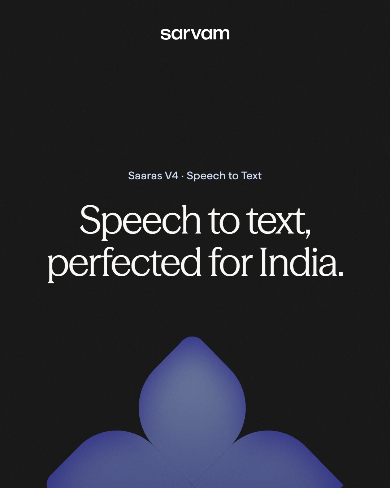
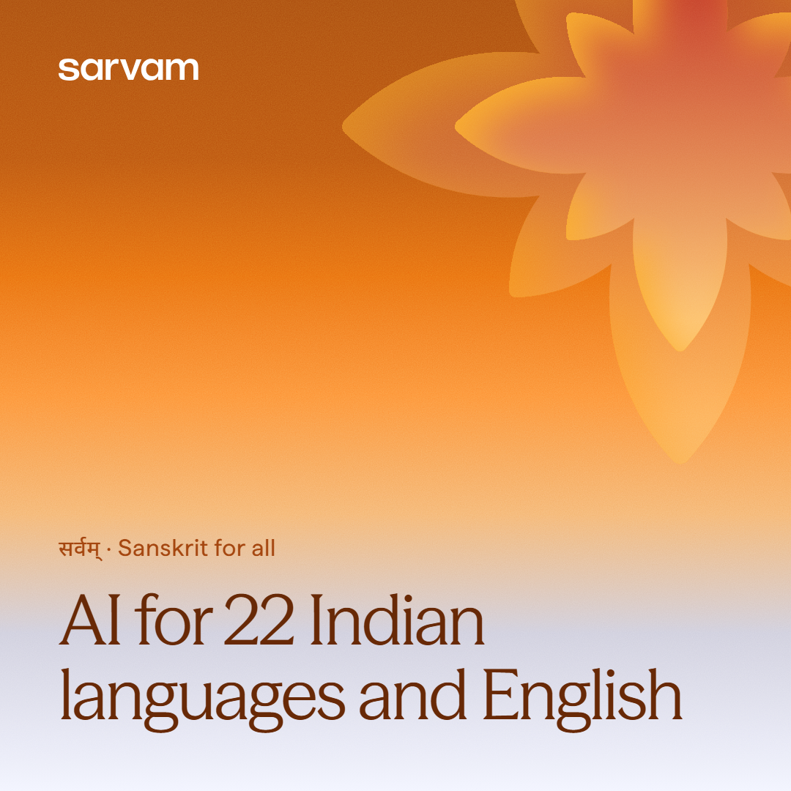
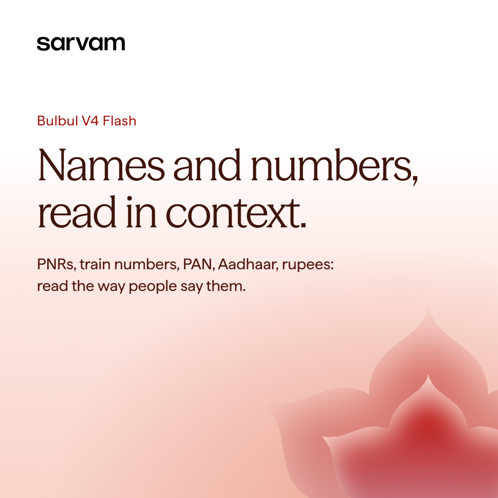
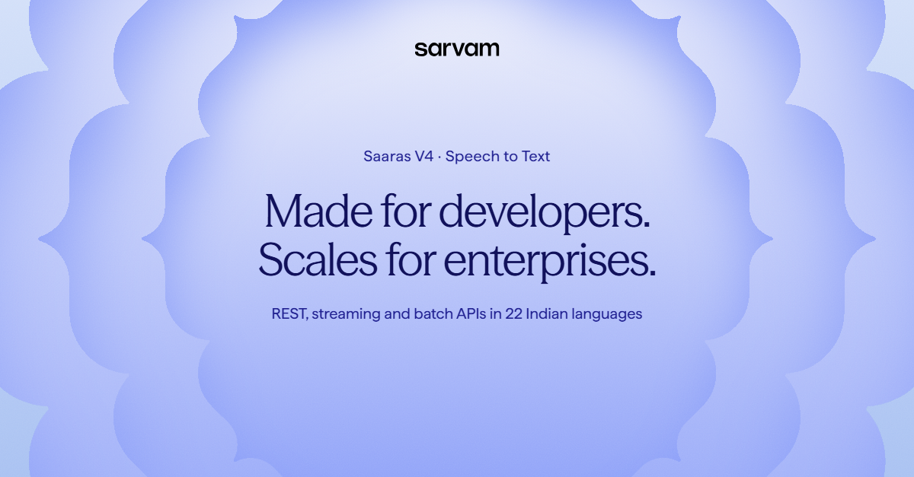
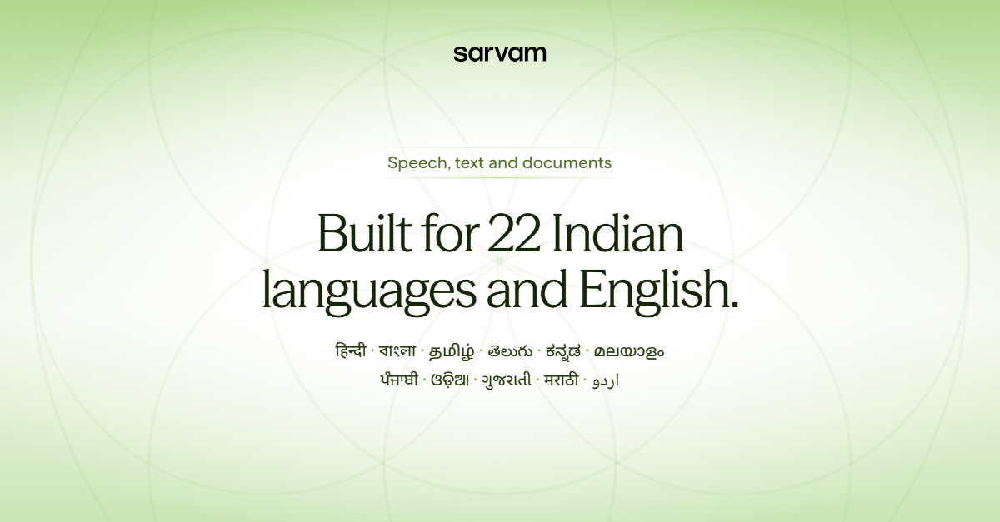
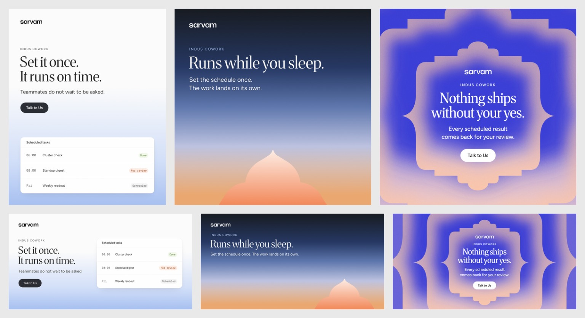

# Testing the system

The real question: can the system produce accurate, consistent work **without me guiding it**? I tested it in four ways.

## 1. Blind tests with fresh AI agents
- **How it worked:** a brand-new AI agent, with no memory of my conversations, got only the project files and a one-line brief. It had to follow the instructions, make the design, check its own work, then tell me every rule it found unclear or contradictory.
- **After each round:** I reviewed every design myself and fixed the rules wherever something was missing or confusing.
- **Facts:** agents could only use facts from the project or sarvam.ai. Anything else had to be marked `TODO: confirm`.

### Banners (4 Meta, 4 LinkedIn)
| Banner | Style, colour and shape | My verdict |
|---|---|---|
|  | Dark poster, charcoal, indigo shape | Clean and on-brand. **Chosen as a deliverable.** |
|  | Sunset gradient, saffron, star shape | On-brand. **Chosen as a deliverable.** |
|  | White into red, lotus shape | Good. **Chosen as a deliverable.** |
| Voice agents: "Let Bulbul take the call." | Deep maroon, pink shape | Strong (kept in my local drafts) |
|  | Layered shape, periwinkle | Strong. **Chosen as a deliverable.** |
|  | Soft green wash, no shape | Good. **Chosen as a deliverable.** |
| Platform proof: "The AI platform India builds on." | Deep amber, saffron shape | Strong (kept in my local drafts) |
| "Sovereign by design." | Blue-to-orange layered shape | The best of the set (kept in my local drafts) |

**What all 8 got right:**
- the logo small at the top;
- headlines in the serif font, in the right colours;
- official shapes, never redrawn;
- no colour or shape repeated;
- every fact taken from a real source.

### Web pages
Two pages were built the same way: one for **Indus Cowork** and one for **the Sarvam platform**. Both came out complete, on-brand and working on every screen size, and both passed every automatic check. I later refined the platform page myself (its shapes, a colour, its closing line and one removed section). Both are kept in my local drafts; Bulbul V4 is the page I delivered.

### What the tests caught (all fixed)
| Problem the agents found | How I fixed it |
|---|---|
| It wasn't clear what counts as a "set" of banners or a "colour world", so agents ran out of options | Defined both clearly: a set is one brief, and there are 8 named colour families |
| The rule for dark backgrounds didn't work for two of the colours | Gave exact colours for every dark background |
| A few shape colours were described wrongly | Checked each one against the actual shape files and corrected them |
| Saaras was given a green shape, but its colours are indigo | Pointed Saaras to indigo shapes |
| Some default sizes in the code didn't match the written rules | Made them match |
| The old web page starter broke several rules | Replaced it with a complete page that follows every rule |
| Two files gave different sizes for the support line | Kept one source of truth |
| No list of India's 22 languages | Added them, written in their own scripts |

## 2. With the system vs without it

These banners come from a general AI image tool, given a similar brief (Indus Cowork) but no design system:
- **It copies one reference:** the layered frames are almost a direct copy of one of Sarvam's brand images.
- **It repeats one look:** the same three messages appear twice, just resized, instead of a varied set.
- **It breaks the rules:** a button is drawn on every image, and the frames aren't Sarvam's official shapes.

With the system, 8 different agents made 8 varied banners, all using official shapes, the right colours and fonts, and real facts.

## 3. Nothing broke when the system got lighter
After the cleanup, I rebuilt all 6 banners and both web pages from the lighter system and compared them with a backup. **All 18 images came out exactly the same, pixel for pixel.** The rules got shorter without changing a single output.

## 4. How much lighter it got
| | Before | After |
|---|---|---|
| All rules, guides and instructions | 126 KB in 14 files | about 70 KB in 12 files |
| What an AI reads to make one banner | 87 KB | about 47 KB |

A script also checked that every colour, size, file path and number from the old rules still exists in the new ones, unless it was removed on purpose.
